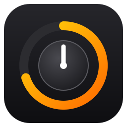

# Timer Dial for Stream Deck+

A countdown timer that lives on **one dial** of a Stream Deck+. Turn to set a time, press to start, hold to reset. The touch strip shows the countdown, and a built-in alarm sound plays when time runs out.



## Install

Double-click `com.jere.timerdial.streamDeckPlugin`. Stream Deck installs it, and **Timer Dial** shows up in the action list. Drag it onto a dial.

You need Stream Deck 7.1 or newer, on Windows 10+ or macOS 12+.

## Controls

**Streamlined** (the default, chosen in the settings panel):

| Gesture | What it does |
|---|---|
| Turn | Set the time. While running, add or remove time. |
| Push + turn | Jump in 5-minute steps. |
| Press | Start / pause. |
| Hold (½ s) | Reset to the time you started with. Hold again for your *Start time*. |
| Tap the strip | Start / pause. A long touch resets. |
| While ringing | Any press, tap or turn stops the alarm. |

Turning uses "smart" steps: 5 s under a minute, 30 s up to 10 min, 1 min up to an hour, then 5 min. Each detent moves the time by a useful amount.

**Classic** (your original design): turn to choose an amount, press to add it (it works while the timer runs too), hold to reset, tap the strip to start/pause.

## Settings panel

- **Controls**: Streamlined or Classic.
- **Start time**: what the dial shows after a reset. Accepts `5`, `4:30`, `90s`, `1h30m`, `1:15:00`. Blank means 0:00.
- **Alarm sound**: 9 built-in sounds, from *Soft Pulse* (quiet) to *Alarm Clock* (urgent), or your own WAV file.
- **Volume** and **Ring for** (once, 10 s to 2 min, or until stopped).
- **Preview**: Play/Stop, so you can audition sounds.

The built-in sounds are synthesised from scratch by `tools/make_sounds.py` and released as public domain (CC0). There's no attribution to track and no licence problem if you ever publish the plugin.

## Build it yourself

You need [Node.js 24+](https://nodejs.org/) and, if you want to regenerate the sounds, Python 3 with `numpy` and `scipy`.

```bash
npm install
npm test              # unit tests for the timer logic (fast, no hardware)
npm run e2e           # builds, then drives the real plugin with a fake Stream Deck
npm run validate      # Elgato's manifest/layout checker
npm run pack          # -> dist/com.jere.timerdial.streamDeckPlugin
```

**Live development loop:**

```bash
npm install -g @elgato/cli
streamdeck dev                                  # enable developer mode
streamdeck link com.jere.timerdial.sdPlugin     # symlink into Stream Deck's plugins folder
npm run watch                                   # rebuild + restart the plugin on every save
```

To debug the settings panel, open http://localhost:23654/ while the panel is visible in Stream Deck. Plugin logs go to `com.jere.timerdial.sdPlugin/logs/`.

## How it's put together

```
src/
  timer/timer.ts        Pure timer logic: state in, new state out. No Stream Deck, no clock.
  render.ts             Timer state -> what the touch strip shows.
  actions/timer-dial.ts Stream Deck glue: dial/touch events, long-press, ticker, alarm.
  audio/player.ts       Plays sound with OS tools (afplay on Mac, PowerShell on Windows).
  audio/wav.ts          Volume scaling for Windows (its built-in player has no volume knob).
  store.ts              Remembers running timers across a Stream Deck restart.
com.jere.timerdial.sdPlugin/
  manifest.json         Plugin metadata Stream Deck reads.
  layouts/timer-dial.json  Touch-strip layout (200 x 100 px).
  ui/timer-dial.html    Settings panel (property inspector).
  sounds/               The alarm WAVs.
test/                   Unit tests + the fake Stream Deck end-to-end test.
tools/make_sounds.py    Sound synthesiser.
```

### Practices worth copying

- **Keep logic pure, keep glue thin.** All the timer rules live in `timer.ts` as plain functions that take `now` as an argument. You can test them in milliseconds without hardware or waiting, and the Stream Deck code only connects events to those functions.
- **Store an end time, not a counter.** A countdown that subtracts 1 every second drifts, and it stops if the PC sleeps. Storing *when it ends* means the timer is always right whenever you look.
- **Only send what changed.** The internal clock ticks 10 times a second, but the plugin only redraws strip items whose content changed: about once a second, well under Elgato's 10-updates-per-second limit.
- **Don't share mutable state with the UI.** The settings panel writes the whole action-settings object at once. Countdown state therefore lives in *global* settings, so the panel can't overwrite it with a stale copy.
- **Pass data via environment variables, not string-building.** The Windows player hands the file path to PowerShell in an environment variable, so a strange file name can't break or inject into the command.
- **Fail safe.** A long-press reset fires while you're still holding the dial, so you know it happened. Spinning a running timer down to zero cancels it instead of setting off the alarm. Every alarm has a hard time limit, even if the plugin crashes.
- **Use the platform's features.** The timer's label is Stream Deck's own *Title* field. Trigger descriptions show the controls inside the Stream Deck app. A custom sound is embedded as a *resource*, so it travels with exported profiles.

## Add your own built-in sound

1. Write a function in `tools/make_sounds.py` that returns a numpy array, and add it to `CATALOGUE`.
2. Run `npm run sounds`.
3. Add the id to `BUILT_IN_SOUNDS` in `src/audio/sounds.ts`, and an `<option>` in `ui/timer-dial.html`.

## Known limitations

- Stream Deck sends the same "disappeared" event whether you switch pages or delete an action. If you delete a timer **while it's running**, it still rings once, for up to your *Ring for* length. Reset it before deleting.
- Custom sounds must be WAV. On Windows, the volume slider only affects 16-bit PCM WAVs (all the built-in ones are). Other WAVs play at full volume.
- After a Stream Deck restart, a running timer resumes once its page is shown. If it ran out more than 2 minutes earlier, it resets quietly instead of ringing.
